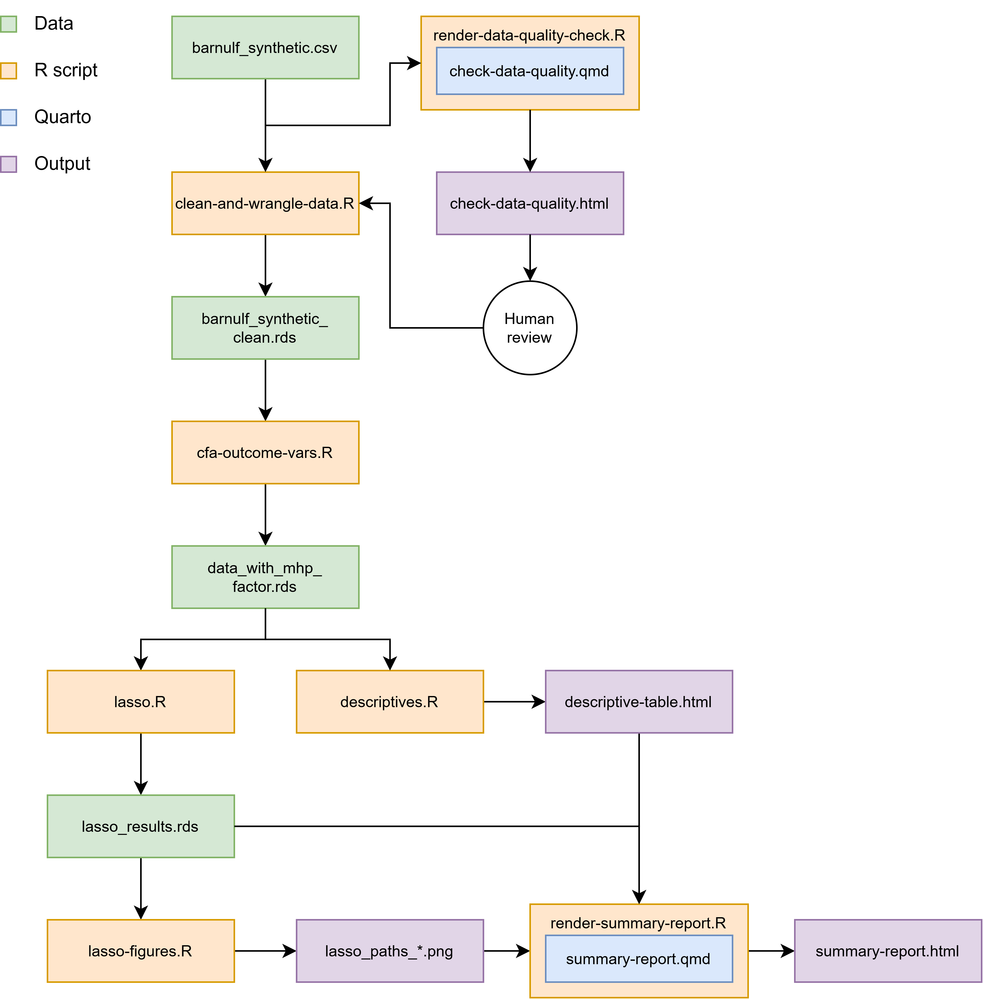

# Purpose
This repository contains all code, synthesized data and other resources related to the BarnULF study conducted at the Department of Disability Research at Linköping University. The study aims to investigate differences in predictors of mental health problems between children and adolescents with and without disabilities using data from a Swedish public registry (BarnULF) collected in 2013-2015 and 2017-2019. The data was synthesized to mimick the properties in the original data set.

# Preregistration
The study was preregistered at [OSF](https://osf.io/96yqx/overview).

# Dependencies

## Software
- [R](https://cran.r-project.org/) (developed on 4.5.2)
- [Quarto](https://quarto.org/) (for rendering `.qmd` reports)

## R packages
- `tidyverse` for data manipulation (dplyr), figures (ggplot2), etc.
- `quarto` for rendering Quarto documents from R
- `psych` for explorative factor analyses
- `lavaan` for confirmatory factor analyses
- `knitr` for formatting tables
- `kableExtra` for styling and formatting tables

Install all packages at once:
```r
install.packages(c("tidyverse", "quarto", "psych", "lavaan", "knitr", "kableExtra"))
```

# Usage

To run the full pipeline from start to finish, execute the following from the repo root:

```r
Rscript run_pipeline.R
```

By running this command, all scripts in /scripts are executed in the logical order (see flowchart below). It is also possible to run scripts in the /scripts folder individually, although some of them depend on objects created by other scripts.

**Figure**

*Flowchart of scripts in pipe and their outputs*



# Scripts

`run-pipeline.r` is the master script that run all the other scripts in the correct order. The scripts in /scripts perform the following actions:

- `clean-and-wrangle-data.r` reads `/data/barnulf_synthetic.csv` and removes variables from the data that are not needed for the purpose of this poject, transforms, and combines other variables according to the description in the preregistration by summing them or calculating factor scores (with exploratory factor analyses) and writes the cleaned up data to `/data/barnulf_synthetic_clean.rds`.

- `check-data-quality.qmd` reads `/data/barnulf_synthetic.csv` and creates a very basic data quality report with histograms (all included variables are categorical or ordinal) and descriptive statistics, informing the data wrangling in ´clean-and-wrangle-data.r´. Output is stored as `/output/check-data-quality.html`

- `render-data-quality-check.r` renders `check-data-quality.qmd` in HTML.

- `descriptives.r` reads `/data/barnulf_synthetic_clean.rds` and creates a table with descriptive statistics of the participants grouped by the year data was collected in´and exports it in HTML format to `/outcome/descriptive_table.html`.

- `cfa-outcome-vars.r` reads `data/barnulf_synthetic_clean.rds` and runs a series of confirmatory factor analyses on 9 items in BarnULF, itaretively adding residual correlations between indicators to the model until no more plausible modifications can be made to the model with the potential to improve model fit, and then extracts a factor score based on the final model, and adds it as a variable to the data. The data is then written to `data/data_with_mhp_factor.rds`.

- `lasso-regression.r` reads `data/data_with_mhp_factor.rds` and runs LASSO regressions for the specified groups to identify variables associated with the mental health problems factor score. The results, including coefficient paths and selected model information, are saved as `data/lasso_results.rds` for further analysis and visualization.

- `lasso-figures.r` reads `data/lasso_results.rds` and creates coefficient path plots for the different disability groups (with n>100 participants), with individual coefficients distinguished by colour. The figures are exported as PNG files to `output/`.